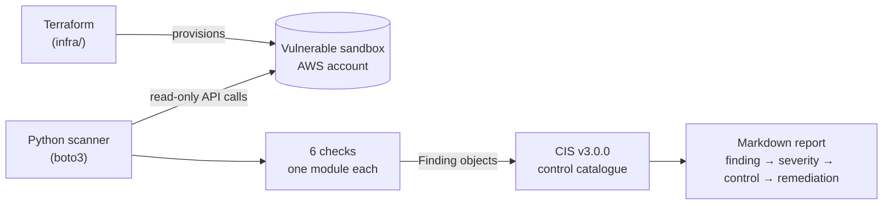

# iam-scanner

**A Python tool that audits an AWS account for common IAM and access misconfigurations and maps every finding to the [CIS AWS Foundations Benchmark v3.0.0](https://www.cisecurity.org/benchmark/amazon_web_services).**

Misconfigured access is one of the most common causes of cloud breaches: public S3 buckets, admin policies nobody needs, console users without MFA, SSH open to the internet, and forgotten access keys. `iam-scanner` finds these, explains why each one matters, and gives remediation steps in a Markdown report. The repo also contains Terraform for a sandbox that is **vulnerable on purpose**, so you can reproduce the scanner's results end to end: `terraform apply` → scan → report → `terraform destroy`.

   

---

## Architecture



- **Terraform** (`infra/`) creates one resource for each misconfiguration in a dedicated AWS account. Each one is contained, so it's detectable but not exploitable. See [Safety](#safety).
- **The scanner** (`src/iam_scanner/`) makes read-only boto3 calls. Each check is a small function that returns structured `Finding` objects: resource, severity, description, evidence and CIS control IDs.
- **The CIS catalogue** (`controls.py`) is the only place control titles, rationale and remediation text live. Checks refer to controls by ID only.
- **The report** sorts findings Critical → Low, then shows the evidence and step-by-step remediation for each one.

## Checks

| Check | Detects | CIS v3.0.0 | Severity |
|---|---|---|---|
| `iam_wildcard_policy` | Customer-managed policies granting `Action: "*"` on `Resource: "*"` that are attached to a user, group or role | 1.16 | 🔴 Critical |
| `s3_public_bucket` | Buckets made public by a bucket policy that Block Public Access doesn't restrict, at the bucket or account level | 2.1.4 | 🔴 Critical |
| `iam_root_mfa` | Root user without MFA | 1.5 | 🔴 Critical |
| `iam_user_mfa` | IAM users with a console password but no active MFA device | 1.10 | 🟠 High |
| `ec2_open_security_group` | Security groups allowing SSH (22) or RDP (3389) from `0.0.0.0/0` or `::/0` | 5.2, 5.3 | 🟠 High |
| `iam_stale_access_keys` | Active access keys unused for ≥ 45 days or older than 90 days (both thresholds configurable) | 1.12, 1.14 | 🟡 Medium |

**Design choices worth a look:**
- **S3 cross-check.** `s3_public_bucket` compares its own policy parsing with AWS's `GetBucketPolicyStatus` verdict. It flags the bucket if either says public, and records any disagreement in the evidence. This catches conditions like `aws:SecureTransport` that look restrictive but aren't.
- **Real-time root MFA.** `iam_root_mfa` uses `GetAccountSummary` rather than the IAM credential report, because AWS can serve a credential report up to 4 hours old. A regression test covers the resulting false positive.
- **Fewer API calls.** The credential report is fetched once per scan and shared by every check that needs it.
- **One failing check doesn't stop the scan.** An `AccessDenied` in one check is listed in the report under "errored checks", and the rest of the scan continues.

## Getting started

### Prerequisites
- **Python 3.11+**
- **Terraform 1.6+**: only needed to provision the sandbox.
- **AWS credentials** for a dedicated sandbox account, configured as an AWS CLI profile. The scanner only reads. The AWS-managed `SecurityAudit` policy covers every API call it makes (`sts:GetCallerIdentity` needs no permission).

### Install
```bash
git clone <repo-url> && cd iam-scanner
python3 -m venv .venv && source .venv/bin/activate
pip install -e ".[dev]"
```

### Run the tests (no AWS account needed)
```bash
pytest
```
All 55 tests run against [moto](https://github.com/getmoto/moto), which fakes AWS locally, with fake credentials. They include:
- a positive and a negative case for every check;
- a golden-file test that locks the report format;
- fixed-timestamp tests that prove the real 45- and 90-day key thresholds.

### Provision the sandbox
Read [Safety](#safety) first.

1. **Precondition:** account-level S3 Block Public Access must be off, or AWS rejects the public bucket policy. See [infra/README.md](infra/README.md) for how to check and change it.
2. Apply the Terraform:
   ```bash
   cd infra
   terraform init
   terraform plan  -var allowed_account_id=<sandbox-account-id> -out sandbox.tfplan
   terraform apply sandbox.tfplan
   ```

The provider refuses to run against any account other than `allowed_account_id`.

### Run a scan
```bash
python -m iam_scanner --profile <sandbox-profile> --region us-east-1
```

| Option | Default | Purpose |
|---|---|---|
| `--profile` | standard credential chain | AWS profile to use |
| `--region` | profile's region, else `us-east-1` | Region for regional checks (EC2 security groups) |
| `-o`, `--output` | `reports/scan.md` | Where to write the report |
| `--checks` | all 6 | Comma-separated check IDs to run |
| `--key-unused-days` | `45` | CIS 1.12 threshold |
| `--key-max-age-days` | `90` | CIS 1.14 threshold |

The scanner prints a one-line summary and **exits with code 1 when there are Critical or High findings**, so it can gate a CI pipeline. It exits with 0 when there are none, and with 2 on errors.

> **Why the demo uses `--key-unused-days 0 --key-max-age-days 0`:** Terraform can't create an access key that is already 90 days old. At the real thresholds, the sandbox's brand-new key is correctly *not* stale. Setting both to 0 makes the key-based findings appear immediately. The moto tests cover the real 45/90-day logic.

### Tear down
```bash
cd infra
terraform destroy -var allowed_account_id=<sandbox-account-id>
```
Then turn account-level S3 Block Public Access back on. The command is in [infra/README.md](infra/README.md).

## Safety

⚠️ **`infra/` creates insecure resources on purpose**: a publicly readable S3 bucket, a console user without MFA, an admin-everything policy, and SSH/RDP open to the internet.

- **Use a dedicated, disposable AWS account.** Never deploy the sandbox to an account with real workloads or data.
- **Don't reuse the sandbox credentials.** The sandbox user's password and access key exist only for testing, and their secrets are stored in plain text in `terraform.tfstate`. That file is gitignored and must never be committed or shared.
- **Destroy the sandbox when you're done.** Every resource is tagged `Project=iam-scanner-sandbox` so leftovers are easy to find.

Each misconfiguration is contained, to limit the damage if it's found:
- the wildcard policy is attached only to an empty group;
- the IAM users have no permissions;
- the open security group sits in a VPC with no subnets, no internet gateway and no instances;
- the public bucket holds only a placeholder file.

## Sample output

Both reports came from a live scan of the sandbox. Account and key IDs are replaced with AWS's documentation placeholders.

| Report | Thresholds | Findings | What it shows |
|---|---|---|---|
| [docs/sample-report.md](docs/sample-report.md) | **Realistic** (45 / 90 days) | 4 | What a real audit would report: the 4 misconfigurations that don't depend on key age. The new access keys are correctly not stale. |
| [docs/sample-report-demo-thresholds.md](docs/sample-report-demo-thresholds.md) | **Demo mode** (0 / 0 days) | 6 | Forces the key-age findings to appear. This also flags the scanning user's own recent key, which is expected at these thresholds. |

## Project layout

```
infra/               Terraform for the vulnerable sandbox
src/iam_scanner/
  checks/            one module per check, plus the registry
  controls.py        CIS v3.0.0 catalogue (titles, rationale, remediation)
  models.py          Finding, Severity, ScanResult
  aws.py             ScanContext: session, thresholds, cached credential report
  report/markdown.py report renderer
  cli.py             command-line interface
tests/               pytest + moto; tests/checks mirrors src/iam_scanner/checks
docs/                sample reports
```

## Possible extensions

- **More root account checks** beyond MFA: root access keys (CIS 1.4), hardware MFA (1.6) and recent root usage (1.7).
- **IAM password policy:** minimum length and reuse prevention (CIS 1.8, 1.9).
- **CloudTrail:** multi-region trail enabled, log file validation, logs encrypted with KMS (CIS 3.x).
- **JSON and SARIF output**, so findings can go straight into GitHub code scanning or a SIEM.
- **Multi-region security group scanning**, sweeping every enabled region instead of one.
- **ACL-based public S3 access**, alongside the existing bucket policy check.
